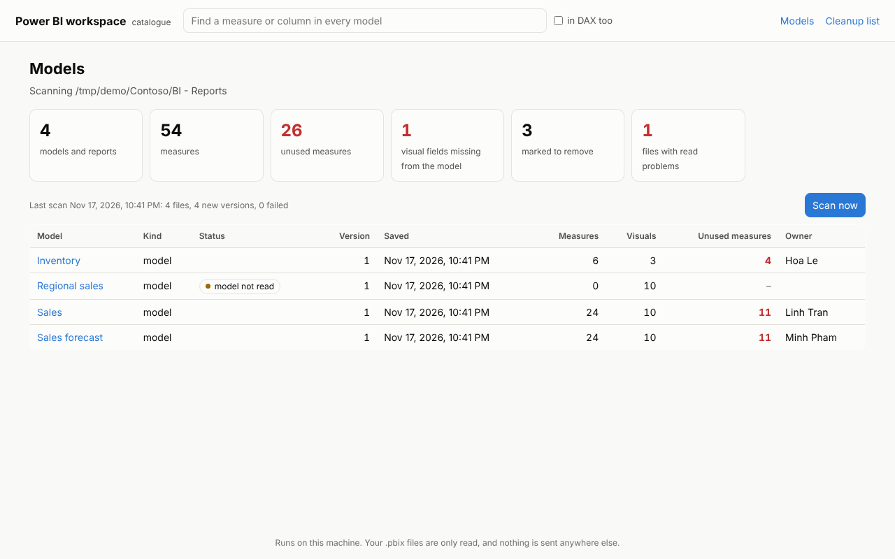
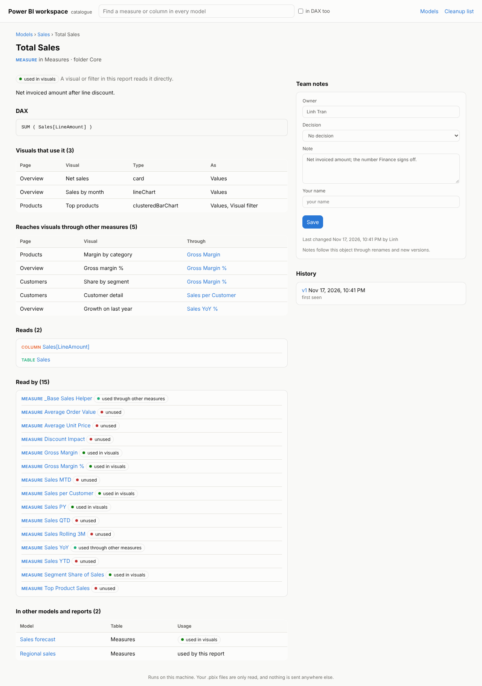
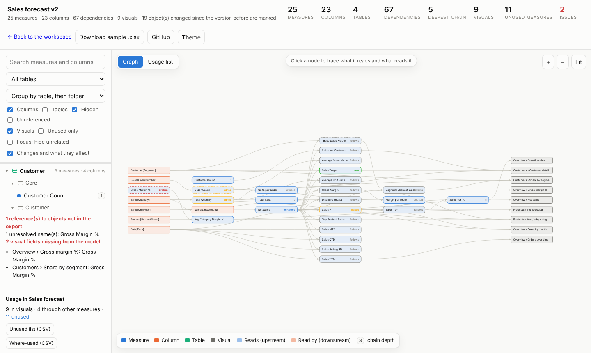
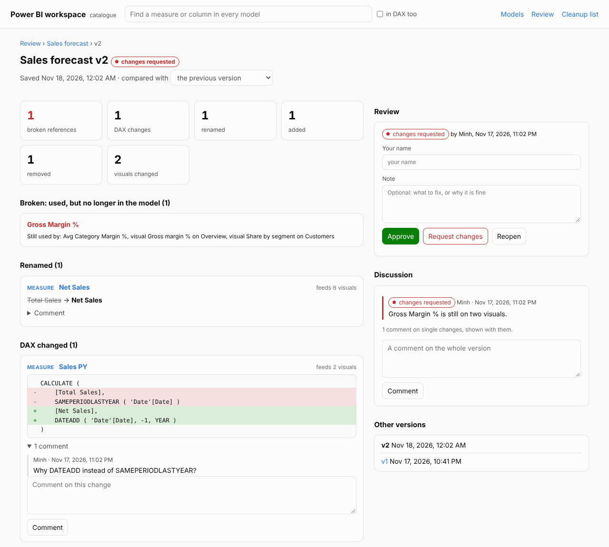
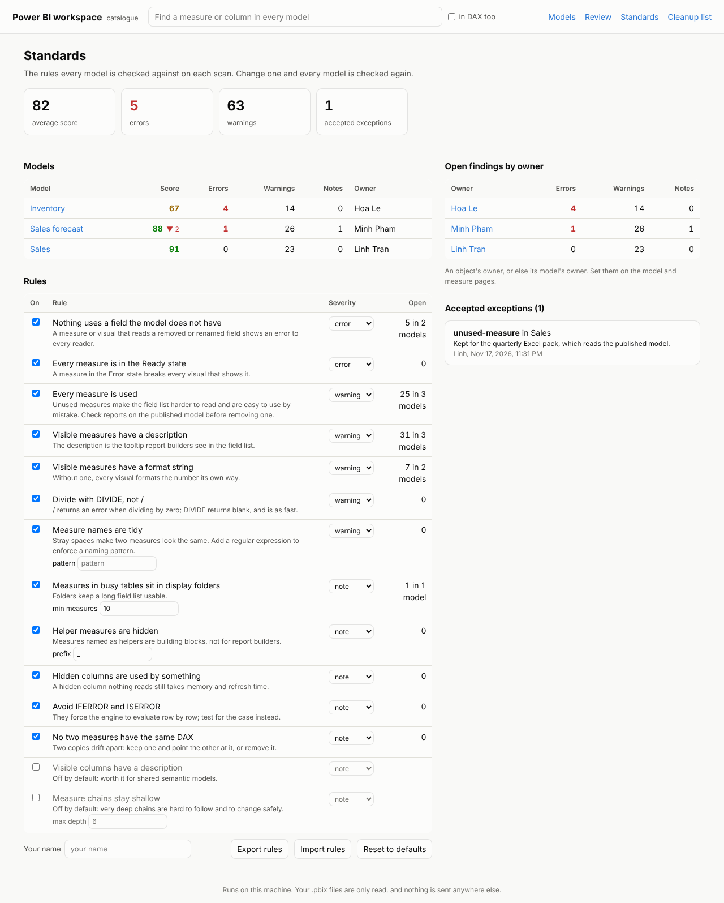
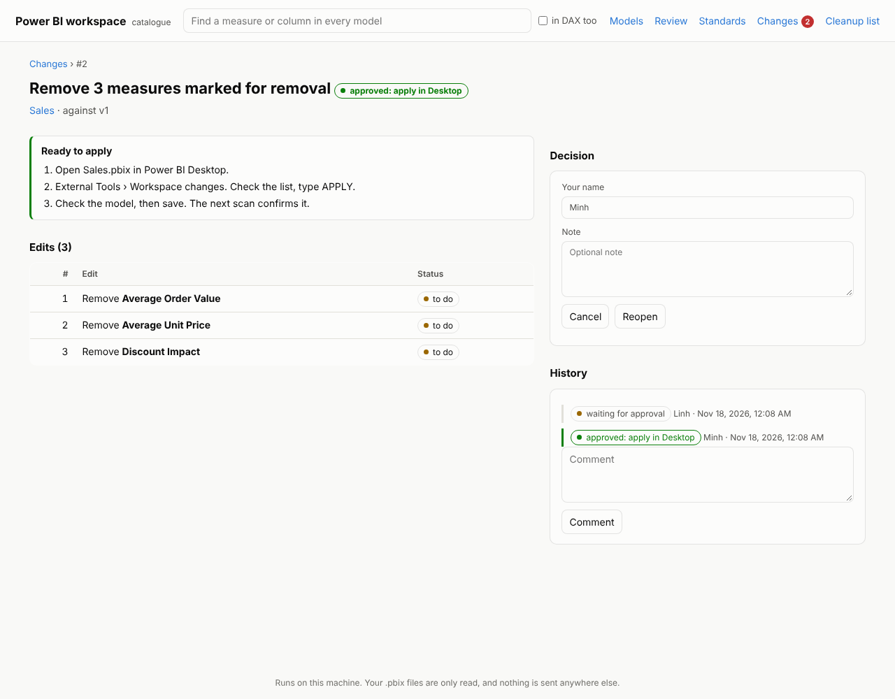
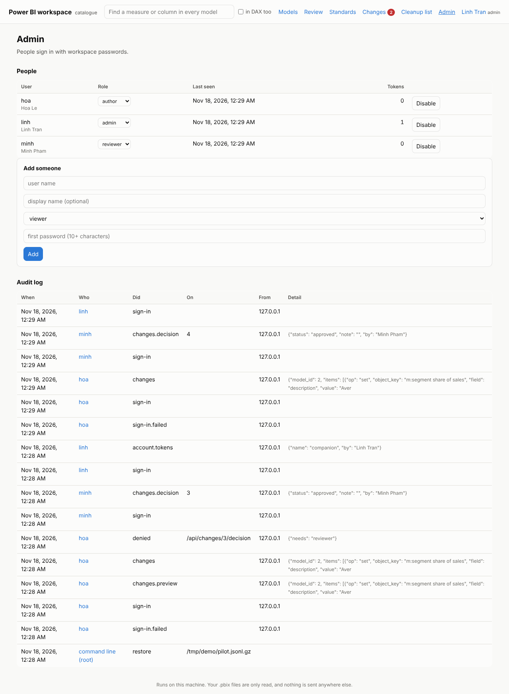

# DAX lineage explorer

See what every DAX measure in a Power BI, Fabric or Analysis Services model reads,
what reads it, **which report visuals use it, and which measures nothing uses at all** — from the
output of one query, [`INFO.MEASURES()`](https://learn.microsoft.com/en-us/dax/info-measures-function-dax),
and the report file.

**Live demo: https://aihtn2708.github.io/DAX-lineage-explorer/** ·
[open it with the sample model loaded](https://aihtn2708.github.io/DAX-lineage-explorer/#sample) ·
[download the sample workbook](https://aihtn2708.github.io/DAX-lineage-explorer/samples/info_sample.xlsx)


## Run it locally

Your model never has to leave your machine. Download the repository
(**Code → Download ZIP** on GitHub, then unzip it), and pick one:

| | Windows | macOS / Linux |
|---|---|---|
| **Easiest: no Python, no server** | double-click `docs\dax-lineage-explorer.html` | open `docs/dax-lineage-explorer.html` |
| **Local server** on 127.0.0.1 | double-click `run-local.bat` | `./run-local.sh` |
| **Same, from a terminal** in the repository folder | `py -m dax_lineage serve` | `python3 -m dax_lineage serve` |
| **For a team**, on your own infrastructure | `docker build -t dax-lineage-explorer .` then `docker run --rm -p 127.0.0.1:8765:8765 dax-lineage-explorer` | same |

The local server opens http://127.0.0.1:8765 in your browser. The launchers
need Python 3.9 or later ([python.org](https://www.python.org/downloads/));
without it they open the offline page instead, which does everything the same
way. Nothing needs installing: `python -m dax_lineage` runs straight from the
repository folder.

Every page carries a Content-Security-Policy under which the browser refuses
any request to another host. The offline page makes exactly one request, for
itself. [SECURITY.md](SECURITY.md) has the details and how to check them,
including a script that audits every request the page makes in a real browser.

**`'daxlin' is not recognized as an internal or external command`** (Windows):
the `daxlin` command exists only after `pip install`, and only if pip's
`Scripts` folder is on your PATH, which it often is not. Use the module form
instead; it takes the same arguments and needs neither:

```
py -m dax_lineage serve
py -m dax_lineage unused -s "Supply Chain Sample.pbix"
```

`python -m dax_lineage …` works the same where the `py` launcher is missing.
If you do want the short command: `py -m pip install -e .`, then add the
`Scripts` folder pip mentions to your PATH (or reopen the terminal).

## Team workspace: every model in one catalogue (preview)

For a team that keeps its `.pbix` files on SharePoint or OneDrive: point the workspace at the synced
folder, and it reads every model each night into a database on your own machine. Then anyone can
find a measure across all models, see which visuals use it, and leave notes, owners and keep/remove
decisions that stay attached to the measure through renames and new versions.

#### Quick start on your PC (Windows, 2 minutes)

1. Install [Python 3.9 or later](https://www.python.org/downloads/) (tick *Add python.exe to PATH*).
2. Download this repository (**Code → Download ZIP**) and unzip it.
3. **Double-click `run-workspace.bat`.** A black window opens (leave it open: it is the workspace)
   and your browser shows http://127.0.0.1:8766.
4. On the page, under **Start here**, click **Browse…** and choose the folder that holds your `.pbix`
   files, for example the SharePoint library OneDrive syncs to your PC. Or paste its path (in File
   Explorer, click the address bar and copy it). Click **Add and scan**.
5. The models appear. Click **Scan now** after you save new versions; to stop, close the black window.

Subfolders are read too, and files are only read, never changed. Everything stays on your PC, in
`pbi-workspace.db` next to `run-workspace.bat`.

**Nothing found?** The scan reads `.pbix` and `.pbit` files (not `.pbip` folders yet). Files that
OneDrive keeps only online are downloaded as they are read: if one fails, right-click the folder in
File Explorer → **Always keep on this device**, then **Scan now** again.

The same from a terminal, for scheduled scans or scripts (`./run-workspace.sh` on macOS and Linux):

```bat
run-workspace.bat add-folder "C:\Users\me\OneDrive - Contoso\BI - Reports"
run-workspace.bat scan
run-workspace.bat                 &REM no arguments: open the page
```

Editing `run-workspace.bat` itself does nothing for the folder: its `rem` lines are comments.



- **Models** lists every file with its version, measures, visuals, unused measures and owner.
- **Search** finds a measure or column by name in every model (tick *in DAX too* to search expressions),
  including reports whose model is published elsewhere.
- **A measure** shows its DAX, the visuals that use it directly and through other measures, what it reads
  and what reads it, the same name in other models, and its history across versions.
- **Team notes**: owner, a note, and *keep* or *remove*. The **Cleanup list** gathers every *remove* across
  models, for the clean-up session.



**Each saved file becomes a version.** A file is read again only when its size or date changed and its
SHA-256 differs, so OneDrive does not download files that are only online. Measures and columns are
matched across versions by their Power BI **LineageTag**, which survives renames, so a note made on
`Total Sales` is still there after it becomes `Net Sales`. A file that fails to read is recorded with
the reason and does not stop the scan; a file that disappears is kept, marked *file not found*.

### The lineage graph, inside the workspace

Every model, measure, review and change opens in the lineage explorer, drawn from what the scan
stored (the .pbix is not read again), for any version:

- **A model or a measure**: *Open the lineage graph* / *Show it in the lineage graph*, centred on it.
- **A review**: *See the changes in the lineage graph* marks what the save changed: new, edited,
  renamed, broken, and DAX that only follows a rename. The graph opens on those and everything
  they affect; untick *Changes and what they affect* for the whole model.
- **A change request**: *See what it touches* marks the objects it will change and the DAX that
  follows them.



The page is the same offline explorer: it makes no request at all, not even to the workspace.

### Reviewing each other's changes

Every saved version after the first waits in **Review**. Opening one shows what changed since the
version before, so a reviewer can approve it without opening Power BI Desktop:

- **Broken references** first: a measure or column that was removed or renamed by hand while a measure or
  visual still uses it, and everything that still uses it.
- **Renamed**, matched by LineageTag. Expressions that changed only because they follow the rename are
  folded away, as are DAX changes that are only formatting or comments.
- **DAX changed**, as a line diff, with how many visuals the measure feeds and what it now reads or no
  longer reads.
- **Added**, **removed** (with the visuals that used it), other property edits (format string, folder,
  hidden, description), measures that became unused or are used again, and visuals added, removed or
  given different fields.

Comment on the whole version or on a single change, then **Approve** or **Request changes**. Any two
versions of a model can be compared. From the terminal, for an e-mail or a Teams post:

```bash
daxlin workspace review                   # what is waiting
daxlin workspace changes "Sales"          # the latest version of Sales, as text
daxlin workspace changes --since 1d       # everything saved since yesterday
```



A synced folder holds only the latest file, so several saves between two scans arrive as one version.
Scan more often to keep them apart: `serve --scan-every 60` rescans every hour while the page is open, and
an unchanged file costs almost nothing to check.

### Standards: one rule set, a score per model

Every scanned version is checked against the team's rules, and each model gets a score from 0 to 100:
the weighted share of checks it passes (errors count 3, warnings 2, notes 1).

| Rule | Default |
|---|---|
| Nothing uses a field the model does not have (broken measure or visual references) | error |
| Every measure is in the Ready state | error |
| Every measure is used (needs the report in the file) | warning |
| Visible measures have a description; and a format string | warning |
| Divide with `DIVIDE`, not `/` | warning |
| Measure names are tidy (no stray spaces), optionally matching a pattern you set | warning |
| Measures in busy tables sit in display folders; helper measures (`_name`) are hidden | note |
| Hidden columns are used by something; avoid `IFERROR`; no two measures with the same DAX | note |
| Visible columns have a description; measure chains stay shallow | off |

- **Standards** shows every model's score and how it moved since the last version, the findings
  per owner (the object's owner, else the model's), and the rules. Turn a rule on or off, change its
  severity or settings, and every model is checked again.
- **Exceptions**: on a measure's page, accept a finding with a reason ("the denominator is never zero").
  It stops counting against the score, and the reason stays visible to everyone.
- **Reviews** show the score before and after, and which findings the save added or fixed.
- **Agree the rules once**: `daxlin workspace rules export -o rules.json` writes the rule set to keep in git
  or hand to another team; `rules import rules.json` loads it.

```bash
daxlin workspace check                       # findings per model; exits 1 if any error is open
daxlin workspace check "Sales" --min warning
daxlin workspace rules set measure-naming --param "pattern=^[A-Z%]"
daxlin workspace rules set column-description --on --severity warning
```



### Safe changes: reviewed, made in Power BI Desktop, confirmed by the scan

The workspace never writes a .pbix. A change is proposed and approved in the workspace, made in the model
open in Power BI Desktop by a small companion on the External Tools ribbon, saved by the author as usual,
and confirmed by the next scan.

- **Propose** from the **Cleanup list** (remove what the team marked), a model's **Describe and organise**
  grid (descriptions, display folders, format strings, hidden), or a measure's page (rename, remove).
  Each edit is checked against the latest version first, and refused when it would break something:
  a measure is removed only when nothing outside the change reads it and no visual shows it.
  A rename rewrites every DAX expression that refers to the measure.
- **Visuals find their fields by name**, and a rename made by a tool leaves them broken. So a measure
  that visuals show is not renamed by the companion: the change asks the author to rename it in
  Desktop's Data pane, which updates the visuals and the DAX, and the scan confirms it.
- **Approve** (someone other than the author, by agreement), then in Desktop: **External Tools ›
  Workspace changes**. The companion lists each edit with what it will do, changes nothing until you
  type `APPLY`, saves a backup of the model's definition first, skips any edit whose object has changed
  since the approval, and reports back. Check the model, save, and the next scan marks the change
  **confirmed**.



**Installing the companion** on each Windows PC with Power BI Desktop (once, as administrator):

```powershell
python -m dax_lineage workspace companion --out C:\Tools\pbi-workspace     # or run-workspace.bat companion
cd C:\Tools\pbi-workspace
powershell -ExecutionPolicy Bypass -File .\install-companion.ps1 -Workspace http://127.0.0.1:8766 -DownloadTom
```

Restart Desktop; **Workspace changes** appears under External Tools. The companion needs Microsoft's
Tabular Object Model library: `-DownloadTom` fetches it from nuget.org; without it the companion uses the
one installed with Tabular Editor 2 or the SqlServer PowerShell module. Point `-Workspace` at the team
server when there is one.

### One workspace for the whole team

A pilot runs on one PC with a SQLite file. A team runs one shared workspace on its own servers,
set up as in [deploy/README.md](deploy/README.md):

- **Postgres** for the database: `--db postgresql://workspace@db.contoso.local/powerbi`
  (`pip install ".[postgres]"`). Everything works the same on either; the tests run on both.
- **Sign-in**: Windows sign-in through IIS (`--auth iis`, nobody types a password), workspace
  passwords (`--auth local`), or any proxy that signs people in (`--auth windows`). Without one,
  the server refuses to listen beyond 127.0.0.1.
- **Roles**: viewer, author, reviewer, admin. Names on notes, reviews and changes come from the
  sign-in, and nobody approves their own change.
- **Audit log** of every change, sign-in and refused attempt; the Admin page shows it with the
  people and their roles.
- **Backups**: `daxlin workspace backup --out file.jsonl.gz` writes one file that `restore` loads into
  SQLite or Postgres, which is also how a pilot moves to the team server.
- **The Desktop companion** signs in with the person's Windows account behind IIS, or with a
  personal token from **My account**.

```bash
daxlin workspace --db pbi-workspace.db backup --out pilot.jsonl.gz                     # the pilot
daxlin workspace --db postgresql://workspace@db/powerbi restore pilot.jsonl.gz          # the team server
daxlin workspace --db postgresql://workspace@db/powerbi users add contoso\linh --role admin
```



**Run the scan every night** with Windows Task Scheduler (or cron on a server):

```bat
schtasks /create /tn "Power BI workspace scan" /sc daily /st 02:00 ^
  /tr "python -m dax_lineage workspace --db D:\pbi\workspace.db scan --quiet"
```

**Privacy and safety.**
- Files are only ever opened for reading; nothing writes to a `.pbix`.
- The database is one SQLite file you choose with `--db` (default `pbi-workspace.db`, or `$DAXLIN_WORKSPACE_DB`).
- The server listens on 127.0.0.1 and loads nothing from anywhere else; its page may call only itself.
- Changes must be JSON POSTs from the page's own origin, so another website cannot send them.
- On a network, sign-in is required (`--auth iis`, `local` or `windows`), unless the server is `--read-only`.

**Limits of this preview.**
- *Unused* means unused by the report inside the same file. Reports built on the published model are scanned
  as *report only* and matched by name; check them before removing anything.
- PBIP folders and models published to the service are not scanned yet.
- The companion has not yet been run against Power BI Desktop by this project: try it on a copy of a .pbix
  first. It makes measure-level edits only (remove, rename, description, folder, format string, hidden).
- Who saved a version is not known from a synced folder, only when.
- Relationships, calculation groups and report-level formatting are not compared yet.

The design behind it is in the project's design document; this completes its five milestones.

## Two ways to use it

Same rules and same results:

- **In the browser** — export the query result to Excel and drop it on the
  [demo page](https://aihtn2708.github.io/DAX-lineage-explorer/). The file is read in your browser tab and
  never uploaded. No install.
- **From the command line** — `daxlin`, a zero-dependency Python package, for CI checks, scripted exports and
  Graphviz / Mermaid / JSON output.

```
pip install -e .
daxlin build model.xlsx -o lineage.html     # the same workbook the page reads
daxlin check model.xlsx                      # exits 1 on cycles, dangling refs, Error states
daxlin unused -s model.xlsx --report Sales.pbix   # exits 1 if any measure is unused
```

## Where used, and unused measures

`INFO.MEASURES()` describes the model; which visuals use a measure lives in the report.
Give the tool both and every measure and column gets a status:

| Status | Meaning |
|---|---|
| **In visuals** | a visual, slicer, filter or conditional format uses it directly |
| **Through other measures** | no visual uses it, but a measure that a visual uses depends on it, so removing it breaks that visual |
| **Model structure** | a column nothing reads, but it is a relationship key or another column's sort-by column |
| **Read only by unused** | only measures that are themselves unused read it: the whole chain can go |
| **Unused** | nothing in the model or the report reads it |

**Usage list** (the tab above the graph) shows it all as one table: every measure or column, its
status, the visuals that use it with page and role, what it is reached through, and what reads it.
Filter it to *Unused*, *Through measures*, *In visuals* or *Keys and sort-by*; click a row for the
full trace.

Clicking a measure lists the visuals that use it, page by page, with the role it plays in each
(axis, values, legend, tooltip, filter, conditional formatting), and the visuals that reach it
through other measures, naming the measure in between. Visuals appear in the graph as the last
layer, so a column can be traced all the way to the cards and charts it ends up in.
**Group by usage** puts the unused ones first; **Unused only** shows just them and what they read;
both lists export to CSV.

Report formats it reads:

| File | What it holds |
|---|---|
| `.pbix` | the report **and** the model: works on its own. The model is decompressed in the browser (XPress9), and decoding stops once its definitions are read, so the data is never loaded |
| `.pbit` (File → Export → Power BI template) | the report and the model as JSON: works on its own, and is smaller |
| PBIP folder (or its zip) | `*.Report/definition/…/visual.json` (PBIR) or `*.Report/report.json`, plus `*.SemanticModel/model.bim` if the model is saved as TMSL |
| report layout `.json` | the `Report/Layout` part on its own |

A visual that uses a field the model no longer has is flagged too: that visual shows an error in
Power BI.

*Unused* means unused in the reports you load. Other reports on the same semantic model, Excel
pivot tables, paginated reports, row-level security rules and calculation groups are not seen, so
load every report that uses the model, and check before deleting.

```
daxlin unused     -s model.xlsx --report "Sales.pbix" --report "Finance.pbix"
daxlin unused     -s "Sales.pbix" --columns-too       # a .pbix carries its model too
daxlin where-used "Total Cost" -s "Sales.pbit"

Total Cost  (measure on Measures)
status: not in a visual, used through other measures

through other measures (3):
  Products > Margin by category  [pivotTable]  via Gross Margin
  Overview > Gross margin %  [card]  via Gross Margin %
  Customers > Share by segment  [clusteredBarChart]  via Gross Margin %
```

## 1. Get the data out of the model

Run the queries in `queries/` and export each result grid. The first is required;
the other two make the graph far more precise.

| Query | Gives the tool | Required |
|---|---|---|
| `queries/info_measures.dax` | measure names, DAX, table, folder, format, state | yes |
| `queries/info_tables.dax` | `TableID` → table name | recommended |
| `queries/info_columns.dax` | the column catalogue, plus calculated-column DAX | recommended |
| `queries/info_relationships.dax` | table-to-table relationship edges | optional |

Where to run them: **Power BI Desktop** → DAX query view; **Fabric** → the DAX
query editor on a semantic model; **DAX Studio / SSMS / Tabular Editor** → any
XMLA endpoint; **Power BI REST** → `POST /datasets/{id}/executeQueries`.

`INFO.COLUMNS` matters more than it looks. DAX resolves a bare `[Amount]` to a
measure if one exists and to a column otherwise — without the column catalogue
the tool cannot tell a column reference from a typo, and says so rather than
guessing.

The easiest shape is **one Excel workbook with a sheet per query**, like
[`info_sample.xlsx`](docs/samples/info_sample.xlsx): paste each result grid into its own sheet. Sheet names
are optional, since each query's columns give it away. Separate CSV, TSV or JSON files work too, and
headers may be `Name`, `[Name]` or `Measures[Name]`. A title line above the header row is skipped.

## 2. Build the page

On the web: drop the workbook on the [demo page](https://aihtn2708.github.io/DAX-lineage-explorer/), or
paste the grid copied from DAX query view.

From the command line, a self-contained page you can keep or send:

```bash
daxlin build model.xlsx -o lineage.html --title "Sales model"
daxlin build exports/  -o lineage.html          # a folder of CSV exports
daxlin build info_measures.csv --columns info_columns.csv --tables info_tables.csv
```

Either way the page needs no server and no network. It has:

- a layered graph, dependencies on the left, dependents on the right, one layer
  per step of the longest chain;
- a sidebar laid out like Power BI's field list: each table, then its display
  folders (nested `Folder\Subfolder` too), then its measures and columns —
  collapsible, and it opens to whatever you click in the graph;
- the **chain depth** beside each measure: how many steps the longest path from
  it down to the model's source columns takes. `1` reads columns directly, like
  `SUM(Sales[Amount])`; `3` is built on a measure built on a measure. High numbers
  are where a change ripples furthest and where a wrong number is hardest to trace;
- click-to-trace: the upstream chain in blue, the downstream chain in orange,
  everything unrelated dimmed, or hidden with **Focus**;
- a detail panel with the DAX, syntax highlighted, whose references are
  clickable — follow `[Gross Margin]` straight to that measure;
- filters for columns, tables, hidden measures and unreferenced columns, a
  search over names, descriptions and expression text, and sorting by chain
  depth or by how often a measure is referenced;
- **Copy subgraph as Mermaid**, for pasting one measure's lineage into a doc;
- light and dark, keyboard `/` to search, `f` to fit, `Esc` to clear.

## 3. Ask it things from the terminal

```bash
daxlin check   -s exports/        # cycles, dangling references, error states, broken visual fields
daxlin deps    "Sales YoY %" -s exports/
daxlin used-by "Total Sales"  -s exports/
daxlin list    -s exports/        # every measure by chain depth
daxlin json    -s exports/ -o lineage.json
daxlin dot     -s exports/ -o lineage.dot      # Graphviz
daxlin mermaid "Gross Margin %" -s exports/
```

`check` exits non-zero when it finds something, so it fits in CI:

```
24 measures, 23 columns, 68 dependencies, deepest chain 5

circular dependencies (1):
  Ratio A -> Ratio B -> Ratio A

unresolved references (2):
  [Refunds]
  [Revenu]
```

## As a library

```python
from pathlib import Path
from dax_lineage import load_catalogue, build_graph, render_html

catalogue = load_catalogue("info_measures.csv", columns_path="info_columns.csv")
lineage = build_graph(catalogue)

print(lineage.stats()["mostReferenced"][:3])
print([lineage.nodes[i].label for i in lineage.upstream("m:gross margin %")])

Path("lineage.html").write_text(render_html(lineage), encoding="utf-8")
```

Node ids are `m:<measure>`, `c:<table>[<column>]`, `t:<table>`, all casefolded.

## What the reference scanner does

`dax_lineage/dax.py` tokenises DAX far enough to be right about what is a
dependency, and no further. It is not a parser and does not need to be.

- Comments (`//`, `--`, `/* */`) and string literals are skipped, so a measure
  name inside either is not a reference.
- `Table[Column]` and `'Table Name'[Column]` are columns; `]]` inside a name is
  an escaped bracket.
- A bare `[Ref]` is a measure if the export has one by that name, otherwise a
  column — the engine's own resolution order.
- `VAR` names are tracked, so `VAR _rows = FILTER(...)` followed by
  `SUMX(_rows, _rows[Amount])` reads `[Amount]` as a column and not `_rows` as a
  table.
- A bare table name is a dependency too: `ALL(Sales)`, `SUMX(Sales, …)`.
- Calculated-column expressions from `INFO.COLUMNS` are scanned the same way, so
  a measure → calculated column → base column chain stays connected.
- Functions are collected per measure and tagged: time intelligence, iterators,
  context modifiers.

What it does not do: evaluate anything, understand filter-context semantics, or
resolve which relationship a reference travels. It reports what a measure reads,
not what the engine does with it.

## Limits worth knowing

- A reference that resolves to neither a measure nor a column is reported, not
  guessed at. With no `INFO.COLUMNS` export, expect many of these.
- The page reads `.xlsx`, not the old binary `.xls`; it says so and asks for a re-save.
- A calculation group's `INFO.CALCULATIONITEMS` is not read yet, so a measure
  reached only through a calculation item shows no edge for it.
- Row-level security, field parameters and detail-rows expressions are not read.
- `INFO.MEASURES` is available in Power BI Desktop and in recent Analysis
  Services; on an older engine use the `$SYSTEM.TMSCHEMA_MEASURES` DMV instead
  and export it the same way — the column names match.

## How the repository is laid out

| Path | What it is |
|---|---|
| `dax_lineage/` | the Python package behind `daxlin` |
| `dax_lineage/pbi_report.py` | reads Power BI reports: .pbix, .pbit, PBIP (PBIR and legacy), model.bim |
| `dax_lineage/pbix_model.py` | reads the model inside a .pbix: XPress9, the backup stream, metadata.sqlitedb |
| `docs/` | the GitHub Pages site: `index.html`, `js/lineage.js` (the scanner, graph and usage, ported), `js/report.js` (the report reader, ported), `js/zip.js`, `js/xlsx.js`, `js/xpress9.js`, `js/sqlite.js`, `js/pbixmodel.js` (dependency-free readers), `js/viewer.js` |
| `dax_lineage/offline.py`, `serve.py` | the single-file offline page, and `daxlin serve` |
| `dax_lineage/workspace/` | the team workspace: `store.py` (the SQLite schema), `scan.py` (folders to versions), `diff.py` (what changed between versions), `rules.py` and `check.py` (the standards), `changes.py` and `companion/` (safe changes), `db.py`, `auth.py` and `backup.py` (the team server), `app.py` and `static/` (the local web app), `cli.py` (`daxlin workspace`) |
| `docs/dax-lineage-explorer.html` | the offline page, built from docs/ by `scripts/build_offline.py` |
| `docs/samples/` | the downloadable samples: workbooks from `scripts/make_samples.py`, reports from `scripts/make_report_samples.py` |
| `queries/` | the `INFO.*` DAX queries, also served from the site |
| `examples/` | the same samples as CSV, the shape the CLI tests read |

The browser port and the Python must agree: `tests/js/parity.test.js` runs both on the sample models, with
and without a report, and compares every node, edge, usage status, where-used entry and statistic.
`scripts/make_report_samples.py` writes one sample report as legacy layout, `.pbix`, `.pbit` and PBIR,
and the tests check that all four give the same answer.

## Development

```bash
python3 -m pytest tests -q                  # 143 Python tests
DAXLIN_TEST_POSTGRES=postgresql://postgres@localhost/ws_test python3 -m pytest tests -q   # the same on Postgres
npm install && npm test                     # JS parity with Python, the .xlsx, report and .pbix readers
DAX_LINEAGE_PBIX=path/to/file.pbix npm test # also check a real .pbix
python3 scripts/make_samples.py             # rebuild docs/samples/*.xlsx and docs/queries/
python3 scripts/make_report_samples.py      # rebuild docs/samples/sample_report*.json
npm run serve                               # the site at http://localhost:8000
python3 scripts/build_offline.py            # rebuild the offline page after changing docs/
node scripts/privacy_audit.js offline       # every request the page makes, in a real browser
```

`examples/` holds a sales model in the shape a real export arrives in, and
`examples/troubled/` a deliberately broken one — a cycle, a dangling reference,
a misspelled measure, a measure in the `Error` state — for exercising `check`.

Licence: Apache-2.0.

## Third-party code

The XPress9 decoder is a port of Microsoft's MIT-licensed library; see
[THIRD_PARTY_NOTICES.md](THIRD_PARTY_NOTICES.md).
