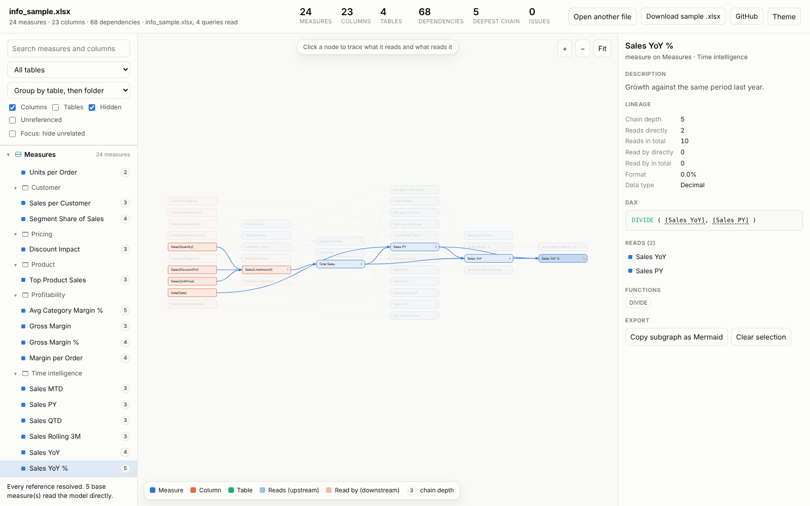

# DAX lineage explorer

See what every DAX measure in a Power BI, Fabric or Analysis Services model reads,
and what reads it — from the output of one query, [`INFO.MEASURES()`](https://learn.microsoft.com/en-us/dax/info-measures-function-dax).

**Live demo: https://aihtn2708.github.io/DAX-lineage-explorer/** ·
[open it with the sample model loaded](https://aihtn2708.github.io/DAX-lineage-explorer/#sample) ·
[download the sample workbook](https://aihtn2708.github.io/DAX-lineage-explorer/samples/info_sample.xlsx)



Two ways to use it, same rules and same results:

- **In the browser** — export the query result to Excel and drop it on the
  [demo page](https://aihtn2708.github.io/DAX-lineage-explorer/). The file is read in your browser tab and
  never uploaded. No install.
- **From the command line** — `daxlin`, a zero-dependency Python package, for CI checks, scripted exports and
  Graphviz / Mermaid / JSON output.

```
pip install -e .
daxlin build model.xlsx -o lineage.html     # the same workbook the page reads
daxlin check model.xlsx                      # exits 1 on cycles, dangling refs, Error states
```

## 1. Get the data out of the model

Run the queries in `queries/` and export each result grid. The first is required;
the other two make the graph far more precise.

| Query | Gives the tool | Required |
|---|---|---|
| `queries/info_measures.dax` | measure names, DAX, table, folder, format, state | yes |
| `queries/info_tables.dax` | `TableID` → table name | recommended |
| `queries/info_columns.dax` | the column catalogue, plus calculated-column DAX | recommended |
| `queries/info_relationships.dax` | table-to-table relationship edges | optional |

Where to run them: **Power BI Desktop** → DAX query view; **Fabric** → the DAX
query editor on a semantic model; **DAX Studio / SSMS / Tabular Editor** → any
XMLA endpoint; **Power BI REST** → `POST /datasets/{id}/executeQueries`.

`INFO.COLUMNS` matters more than it looks. DAX resolves a bare `[Amount]` to a
measure if one exists and to a column otherwise — without the column catalogue
the tool cannot tell a column reference from a typo, and says so rather than
guessing.

The easiest shape is **one Excel workbook with a sheet per query**, like
[`info_sample.xlsx`](docs/samples/info_sample.xlsx): paste each result grid into its own sheet. Sheet names
are optional, since each query's columns give it away. Separate CSV, TSV or JSON files work too, and
headers may be `Name`, `[Name]` or `Measures[Name]`. A title line above the header row is skipped.

## 2. Build the page

On the web: drop the workbook on the [demo page](https://aihtn2708.github.io/DAX-lineage-explorer/), or
paste the grid copied from DAX query view.

From the command line, a self-contained page you can keep or send:

```bash
daxlin build model.xlsx -o lineage.html --title "Sales model"
daxlin build exports/  -o lineage.html          # a folder of CSV exports
daxlin build info_measures.csv --columns info_columns.csv --tables info_tables.csv
```

Either way the page needs no server and no network. It has:

- a layered graph, dependencies on the left, dependents on the right, one layer
  per step of the longest chain;
- a sidebar laid out like Power BI's field list: each table, then its display
  folders (nested `Folder\Subfolder` too), then its measures and columns —
  collapsible, and it opens to whatever you click in the graph;
- the **chain depth** beside each measure: how many steps the longest path from
  it down to the model's source columns takes. `1` reads columns directly, like
  `SUM(Sales[Amount])`; `3` is built on a measure built on a measure. High numbers
  are where a change ripples furthest and where a wrong number is hardest to trace;
- click-to-trace: the upstream chain in blue, the downstream chain in orange,
  everything unrelated dimmed, or hidden with **Focus**;
- a detail panel with the DAX, syntax highlighted, whose references are
  clickable — follow `[Gross Margin]` straight to that measure;
- filters for columns, tables, hidden measures and unreferenced columns, a
  search over names, descriptions and expression text, and sorting by chain
  depth or by how often a measure is referenced;
- **Copy subgraph as Mermaid**, for pasting one measure's lineage into a doc;
- light and dark, keyboard `/` to search, `f` to fit, `Esc` to clear.

## 3. Ask it things from the terminal

```bash
daxlin check   -s exports/        # cycles, dangling references, error states
daxlin deps    "Sales YoY %" -s exports/
daxlin used-by "Total Sales"  -s exports/
daxlin list    -s exports/        # every measure by chain depth
daxlin json    -s exports/ -o lineage.json
daxlin dot     -s exports/ -o lineage.dot      # Graphviz
daxlin mermaid "Gross Margin %" -s exports/
```

`check` exits non-zero when it finds something, so it fits in CI:

```
24 measures, 23 columns, 68 dependencies, deepest chain 5

circular dependencies (1):
  Ratio A -> Ratio B -> Ratio A

unresolved references (2):
  [Refunds]
  [Revenu]
```

## As a library

```python
from pathlib import Path
from dax_lineage import load_catalogue, build_graph, render_html

catalogue = load_catalogue("info_measures.csv", columns_path="info_columns.csv")
lineage = build_graph(catalogue)

print(lineage.stats()["mostReferenced"][:3])
print([lineage.nodes[i].label for i in lineage.upstream("m:gross margin %")])

Path("lineage.html").write_text(render_html(lineage), encoding="utf-8")
```

Node ids are `m:<measure>`, `c:<table>[<column>]`, `t:<table>`, all casefolded.

## What the reference scanner does

`dax_lineage/dax.py` tokenises DAX far enough to be right about what is a
dependency, and no further. It is not a parser and does not need to be.

- Comments (`//`, `--`, `/* */`) and string literals are skipped, so a measure
  name inside either is not a reference.
- `Table[Column]` and `'Table Name'[Column]` are columns; `]]` inside a name is
  an escaped bracket.
- A bare `[Ref]` is a measure if the export has one by that name, otherwise a
  column — the engine's own resolution order.
- `VAR` names are tracked, so `VAR _rows = FILTER(...)` followed by
  `SUMX(_rows, _rows[Amount])` reads `[Amount]` as a column and not `_rows` as a
  table.
- A bare table name is a dependency too: `ALL(Sales)`, `SUMX(Sales, …)`.
- Calculated-column expressions from `INFO.COLUMNS` are scanned the same way, so
  a measure → calculated column → base column chain stays connected.
- Functions are collected per measure and tagged: time intelligence, iterators,
  context modifiers.

What it does not do: evaluate anything, understand filter-context semantics, or
resolve which relationship a reference travels. It reports what a measure reads,
not what the engine does with it.

## Limits worth knowing

- A reference that resolves to neither a measure nor a column is reported, not
  guessed at. With no `INFO.COLUMNS` export, expect many of these.
- The page reads `.xlsx`, not the old binary `.xls`; it says so and asks for a re-save.
- A calculation group's `INFO.CALCULATIONITEMS` is not read yet, so a measure
  reached only through a calculation item shows no edge for it.
- Row-level security, field parameters and detail-rows expressions are not read.
- `INFO.MEASURES` is available in Power BI Desktop and in recent Analysis
  Services; on an older engine use the `$SYSTEM.TMSCHEMA_MEASURES` DMV instead
  and export it the same way — the column names match.

## How the repository is laid out

| Path | What it is |
|---|---|
| `dax_lineage/` | the Python package behind `daxlin` |
| `docs/` | the GitHub Pages site: `index.html`, `js/lineage.js` (the scanner and graph, ported), `js/xlsx.js` (a dependency-free .xlsx reader), `js/viewer.js` |
| `docs/samples/` | the downloadable sample workbooks, built by `scripts/make_samples.py` |
| `queries/` | the `INFO.*` DAX queries, also served from the site |
| `examples/` | the same samples as CSV, the shape the CLI tests read |

The browser port and the Python must agree: `tests/js/parity.test.js` runs both on the sample models and
compares every node, edge and statistic.

## Development

```bash
python3 -m pytest tests -q                  # 50 Python tests
npm install && npm test                     # JS parity with Python + the .xlsx reader
python3 scripts/make_samples.py             # rebuild docs/samples/*.xlsx and docs/queries/
npm run serve                               # the site at http://localhost:8000
```

`examples/` holds a sales model in the shape a real export arrives in, and
`examples/troubled/` a deliberately broken one — a cycle, a dangling reference,
a misspelled measure, a measure in the `Error` state — for exercising `check`.

Licence: Apache-2.0.
